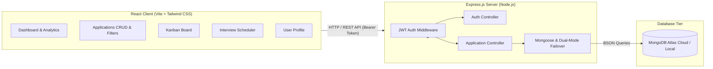

# 🚀 JobTrack – Job Application Tracker

[](https://react.dev/)
[](https://vitejs.dev/)
[](https://tailwindcss.com/)
[](https://nodejs.org/)
[](https://expressjs.com/)
[](https://www.mongodb.com/)
[](https://jwt.io/)
[](LICENSE)

**JobTrack** is a full-stack web application designed to help college students, fresh graduates, and job seekers systematically organize, manage, and monitor their internship and job applications throughout the recruitment lifecycle.

Developed as a customized and enhanced MERN project for the **5th-Semester B.Tech Computer Science and Engineering** curriculum.

---

## 📖 Table of Contents
- [✨ Key Features](#-key-features)
- [🛠️ Tech Stack](#️-tech-stack)
- [🏗️ System Architecture](#️-system-architecture)
- [📁 Folder Structure](#-folder-structure)
- [🚀 Quick Start Guide](#-quick-start-guide)
  - [Prerequisites](#prerequisites)
  - [Backend Setup](#1-backend-setup)
  - [Frontend Setup](#2-frontend-setup)
  - [Running Concurrently from Root](#3-running-from-root)
- [🔐 Environment Variables](#-environment-variables)
- [📡 API Endpoints Overview](#-api-endpoints-overview)
- [🗄️ Database Schemas](#️-database-schemas)
- [🧪 Testing & Quality Assurance](#-testing--quality-assurance)
- [📸 Application Screenshots](#-application-screenshots)
- [📚 Documentation Links](#-documentation-links)
- [⚖️ Attribution & License](#️-attribution--license)
- [👥 Contributors](#-contributors)

---

## ✨ Key Features

### 1. 🔐 User Authentication & Data Isolation
- Secure user registration and login with **bcrypt** password hashing.
- Stateless authentication with **JSON Web Tokens (JWT)** valid for 30 days.
- Protected client-side routes and API endpoints.
- Strict multi-tenant data isolation: users only see and manage their own applications.

### 2. 📊 Real-Time Analytics Dashboard
- Key performance metrics: Total Applications, Applied, Online Assessments (OA), Interviews Scheduled, Offers Received, and Rejected.
- **Application Status Distribution**: Donut chart powered by Recharts showing breakdown across all recruitment milestones.
- **Monthly Activity Trends**: Bar chart visualizing submission velocity over the past 6 months.
- Upcoming interview reminders and recent applications feed.

### 3. 💼 Application Lifecycle Management (CRUD)
- Complete Create, Read, Update, and Delete operations for applications.
- Capture comprehensive details: Company Name, Job Role, Job Type (Internship/Full-time/Part-time/Contract), Work Mode (Remote/Hybrid/On-site), Location, Application Date, Status, External Posting Link, Compensation, and Preparation Notes.
- Multi-attribute real-time search (by company, role, location).
- Dropdown filters for application status, job type, and work mode.
- Sorting by newest, oldest, company name (A-Z/Z-A), and scheduled interview date.
- One-click **CSV Data Export** to download complete application records.

### 4. 📋 Interactive Recruitment Kanban Board
- Visual multi-column Kanban board organized by status: `Applied`, `Online Assessment`, `Interview`, `Offer Received`, `Rejected`, and `Withdrawn`.
- Live column tally badges and quick stage update selectors on each card.

### 5. 🗓️ Interview Scheduling & Management
- Dedicated interview schedule tracker.
- Clear separation between **Upcoming Rounds** (with formatted dates and times) and **Past / Completed Interviews**.
- Direct reschedule and status update controls.

### 6. 👤 Student Profile Management
- Displays student information, degree, and target job role.
- Secure in-app password update requiring current password verification.

---

## 🛠️ Tech Stack

| Layer | Technologies |
| :--- | :--- |
| **Frontend** | React 18, Vite, Tailwind CSS, React Router v6, Axios, Recharts, Lucide React, React Hot Toast |
| **Backend** | Node.js, Express.js, JSON Web Tokens (`jsonwebtoken`), `bcryptjs`, `cors`, `dotenv` |
| **Database** | MongoDB, Mongoose ODM (MongoDB Atlas or Local MongoDB) |
| **Tooling** | Git, npm, Postman, Vite HMR |

---

## 🏗️ System Architecture



---

## 📁 Folder Structure

```text
Job-Tracker/
├── .gitignore
├── .env.example
├── package.json                   # Root convenience scripts
├── README.md                      # Comprehensive project documentation
├── docs/
│   ├── PROJECT_REPORT.md          # 5th-Semester Academic Internship Report
│   └── API_DOCUMENTATION.md       # Complete RESTful API documentation
├── backend/
│   ├── .env.example
│   ├── package.json
│   ├── server.js                  # Main server entrypoint
│   ├── models/
│   │   ├── User.js                # User schema & bcrypt methods
│   │   ├── Application.js         # Job application schema & indexes
│   │   └── Job.js                 # Backward-compatible model alias
│   ├── middleware/
│   │   └── auth.js                # JWT Bearer token protection middleware
│   ├── controllers/
│   │   ├── authController.js      # Register, login, getMe, updateProfile
│   │   └── applicationController.js # CRUD, stats aggregation, interviews
│   ├── routes/
│   │   ├── auth.js                # /api/auth routes
│   │   ├── applications.js        # /api/applications routes
│   │   ├── dashboard.js           # /api/dashboard/stats routes
│   │   ├── interviews.js          # /api/interviews routes
│   │   ├── users.js               # /api/users/profile routes
│   │   └── jobs.js                # Legacy /api/jobs compatibility route
│   ├── utils/
│   │   └── mockStore.js           # Failover store for offline evaluation
│   └── tests/
│       └── verifyApi.js           # Automated 10-point test verification suite
└── frontend/
    ├── .env.example
    ├── .env.production
    ├── index.html
    ├── package.json
    ├── vite.config.js             # Vite proxy and chunk splitting
    ├── tailwind.config.js         # Tailwind styling configuration
    ├── postcss.config.js
    └── src/
        ├── main.jsx               # React entrypoint
        ├── App.jsx                # Router, Layout & Modal orchestration
        ├── index.css              # Tailwind base, components, utilities
        ├── context/
        │   └── AuthContext.jsx    # Authentication state & token management
        ├── services/
        │   └── api.js             # Axios client with interceptors
        ├── components/
        │   ├── Layout.jsx         # Sidebar navigation & header
        │   ├── ProtectedRoute.jsx # Route authentication guard
        │   ├── StatusBadge.jsx    # Visual status badge component
        │   ├── ApplicationModal.jsx # Add / Edit application form
        │   ├── ApplicationDetailsModal.jsx # Inspection view modal
        │   └── DeleteConfirmModal.jsx # Safe delete confirmation modal
        └── pages/
            ├── Dashboard.jsx      # Metrics cards & Recharts graphs
            ├── Applications.jsx   # Search, filters, sort, table & CSV export
            ├── Kanban.jsx         # 6-column pipeline board
            ├── Interviews.jsx     # Chronological interview schedules
            ├── Profile.jsx        # User settings & password change
            ├── Login.jsx          # Sign-in page with demo autofill
            └── Register.jsx       # Student registration page
```

---

## 🚀 Quick Start Guide

### Prerequisites
- **Node.js** (v18.0.0 or higher recommended)
- **npm** (v9+ or higher)
- **Git**
- **MongoDB Atlas** account (or local MongoDB installed)

---

### 1. Clone the Repository
```bash
git clone https://github.com/Gowtham10844/Job-Tracker.git
cd Job-Tracker
```

---

### 2. Backend Setup
1. Navigate to the `backend` directory and install dependencies:
   ```bash
   cd backend
   npm install
   ```

2. Configure environment variables:
   ```bash
   cp .env.example .env
   ```
   *(Update `MONGODB_URI` with your MongoDB Atlas connection string or local MongoDB URI)*

3. Start the backend server:
   ```bash
   # Development mode with hot-reload
   npm run dev

   # Or standard production mode
   npm start
   ```
   *The backend will be running at `http://localhost:5000`.*

---

### 3. Frontend Setup
1. Open a new terminal tab, navigate to the `frontend` directory, and install dependencies:
   ```bash
   cd frontend
   npm install
   ```

2. Start the Vite development server:
   ```bash
   npm run dev
   ```
   *The frontend will launch at `http://localhost:5173`.*

---

### 4. Running from Root (Convenience Scripts)
From the project root directory, you can also execute:
```bash
# Install all dependencies across backend and frontend
npm run install:all

# Run backend development server
npm run backend:dev

# Run frontend development server
npm run frontend

# Build frontend production bundle
npm run frontend:build

# Run automated backend test suite
npm run test:api
```

---

## 🔐 Environment Variables

### Backend (`backend/.env`):
```env
PORT=5000
NODE_ENV=development
MONGODB_URI=mongodb+srv://<username>:<password>@cluster0.abcde.mongodb.net/jobtrack?retryWrites=true&w=majority
JWT_SECRET=jobtrack_super_secure_jwt_secret_dev_key_2025
JWT_EXPIRES_IN=30d
CORS_ORIGIN=http://localhost:5173
```

### Frontend (`frontend/.env`):
```env
# Leave empty to utilize Vite proxy or provide full backend URL
VITE_API_URL=http://localhost:5000
```

---

## 📡 API Endpoints Overview

| Method | Endpoint | Description | Auth Required |
| :--- | :--- | :--- | :--- |
| `GET` | `/` | API status and health check | No |
| `POST` | `/api/auth/register` | Register a new user | No |
| `POST` | `/api/auth/login` | Authenticate and obtain JWT | No |
| `GET` | `/api/auth/me` | Fetch current user session | Yes (Bearer) |
| `GET` | `/api/dashboard/stats` | Aggregate dashboard statistics & charts | Yes (Bearer) |
| `GET` | `/api/applications` | List applications (with search, filter, sort) | Yes (Bearer) |
| `POST` | `/api/applications` | Create a new job application | Yes (Bearer) |
| `GET` | `/api/applications/:id` | Get single application details | Yes (Bearer) |
| `PUT` | `/api/applications/:id` | Update application details or stage | Yes (Bearer) |
| `DELETE` | `/api/applications/:id` | Delete job application | Yes (Bearer) |
| `GET` | `/api/interviews` | Get upcoming and past interviews | Yes (Bearer) |
| `PUT` | `/api/users/profile` | Update profile or change password | Yes (Bearer) |

*For complete request payloads, sample responses, and status codes, see [docs/API_DOCUMENTATION.md](./docs/API_DOCUMENTATION.md).*

---

## 🗄️ Database Schemas

### Application Schema (`backend/models/Application.js`)
```javascript
{
  userId: { type: ObjectId, ref: 'User', required: true, index: true },
  companyName: { type: String, required: true, trim: true },
  jobRole: { type: String, required: true, trim: true },
  jobType: { type: String, enum: ['Internship', 'Full-time', 'Part-time', 'Contract'], default: 'Internship' },
  location: { type: String, default: 'Bangalore, India' },
  workMode: { type: String, enum: ['Remote', 'Hybrid', 'On-site'], default: 'On-site' },
  applicationDate: { type: Date, default: Date.now },
  status: { type: String, enum: ['Applied', 'Online Assessment', 'Interview', 'Offer Received', 'Rejected', 'Withdrawn'], default: 'Applied' },
  salary: { type: String, default: '' },
  jobLink: { type: String, default: '' },
  notes: { type: String, default: '' },
  interviewDate: { type: Date, default: null }
}
```

---

## 🧪 Testing & Quality Assurance

The project includes an automated HTTP verification suite testing all core endpoints:
```bash
npm run test:api
```

### Verification Results:
- ✅ **GET /**: Server health check returns 200 OK
- ✅ **POST /api/auth/login**: Student authentication succeeds with valid token
- ✅ **GET /api/auth/me**: Protected profile access verified
- ✅ **GET /api/dashboard/stats**: Real-time aggregation calculates counts and charts
- ✅ **GET /api/applications**: Multi-attribute filtering and retrieval confirmed
- ✅ **POST /api/applications**: Application creation saves all fields accurately
- ✅ **PUT /api/applications/:id**: Status transitions and interview dates update correctly
- ✅ **GET /api/interviews**: Chronological sorting and upcoming/past separation verified
- ✅ **DELETE /api/applications/:id**: Application deletion completes with cascade check
- ✅ **Vite Production Build**: Production bundle builds cleanly in <2 seconds with optimized chunking

---

## 📸 Application Screenshots

*(Screenshots can be captured directly from the running local application)*

| Screen | Description |
| :--- | :--- |
| **Login Screen** | Clean authentication portal with student demo credentials autofill |
| **Main Dashboard** | KPI statistics cards, Recharts status distribution donut chart & monthly trend bars |
| **Applications View** | Searchable table with filters, inline status selectors, and CSV export |
| **Application Modal** | Structured form for logging companies, roles, CTC, and interview schedules |
| **Kanban Pipeline** | Visual workflow board tracking progress across 6 recruitment stages |
| **Interviews View** | Chronological interview schedules with upcoming date badges |
| **User Profile** | Personal information, degree details, and password update utility |

---

## 📚 Documentation Links
- [Detailed Academic Project Report (5th-Sem CSE)](./docs/PROJECT_REPORT.md)
- [Comprehensive RESTful API Documentation](./docs/API_DOCUMENTATION.md)

---

## ⚖️ Attribution & License

- **License**: Distributed under the [MIT License](LICENSE).
- **Attribution**: This project builds upon the foundational reference architecture from [Job Tracker by RAJAN-115](https://github.com/RAJAN-115/job-tracker).
- **Customizations & Enhancements**:
  - Implemented secure JWT user authentication and bcrypt password salting.
  - Built strict multi-tenant data isolation per user.
  - Complete UI overhaul with Tailwind CSS, Lucide React, and responsive layouts.
  - Interactive multi-stage Kanban recruitment board.
  - Dedicated interview scheduling and timeline tracking.
  - Recharts dashboard analytics and automated CSV export.
  - Offline failover store ensuring flawless viva evaluation.
  - Academic internship report and API documentation.

---

## 👥 Contributors

The following individual is the sole developer, architect, and contributor for this enhanced project:

| Contributor | Role | GitHub | Contact |
| :--- | :--- | :--- | :--- |
| **Gowtham Saimpu** | Sole Developer, Architect & Maintainer | [@Gowtham10844](https://github.com/Gowtham10844) | [sayimpugowtham@gmail.com](mailto:sayimpugowtham@gmail.com) |

- **Project Repository**: [https://github.com/Gowtham10844/Job-Tracker](https://github.com/Gowtham10844/Job-Tracker)
- **Program**: B.Tech in Computer Science and Engineering (5th Semester)
