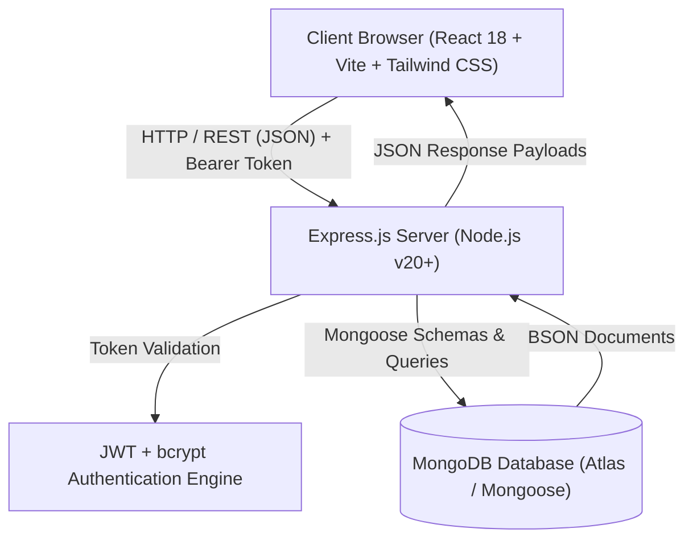
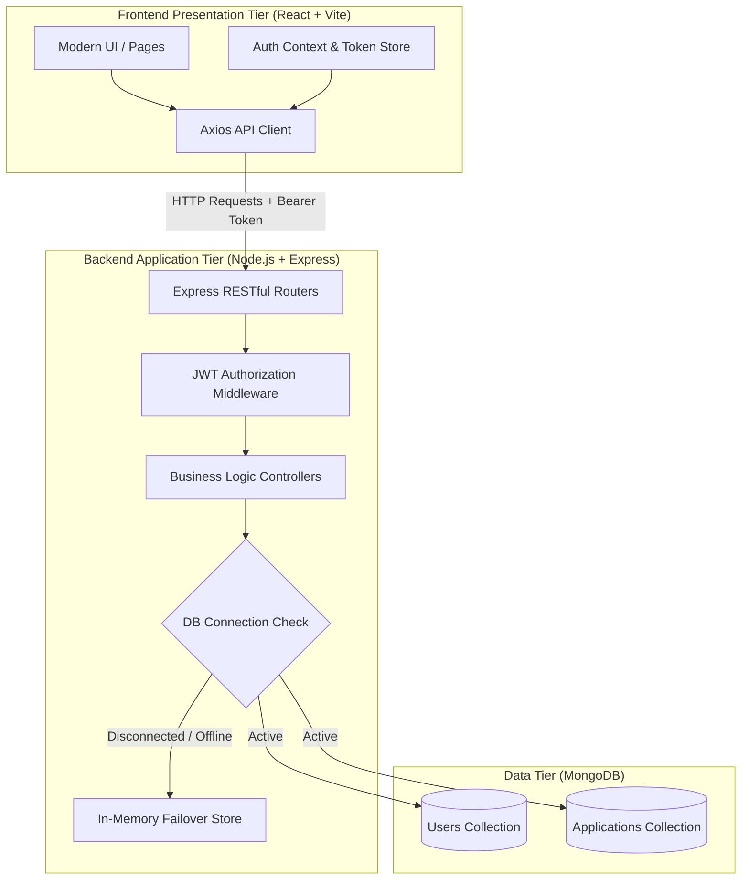
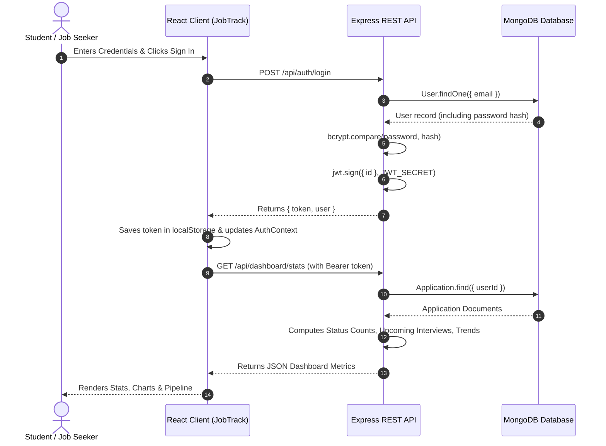
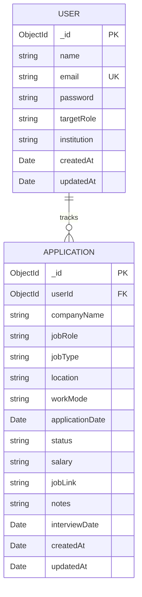

# ACADEMIC INTERNSHIP PROJECT REPORT

---

## **PROJECT TITLE**
# **JobTrack – Job Application Tracker**
### *A Production-Grade Full-Stack MERN Application for Recruitment Pipeline & Interview Lifecycle Management*

---

### **COURSE & SUBJECT DETAILS**
- **Degree**: Bachelor of Technology (B.Tech)
- **Branch**: Computer Science and Engineering (CSE)
- **Semester**: 5th Semester
- **Subject**: Internship / Practical Training (1-Credit Practical Assessment)
- **Academic Year**: 2025–2026

---

### **CANDIDATE INFORMATION**
- **Student Name**: Gowtham Saimpu
- **GitHub Username**: [Gowtham10844](https://github.com/Gowtham10844)
- **Contact Email**: [sayimpugowtham@gmail.com](mailto:sayimpugowtham@gmail.com)
- **Project Repository**: [https://github.com/Gowtham10844/Job-Tracker](https://github.com/Gowtham10844/Job-Tracker)
- **Original Reference Baseline**: [https://github.com/RAJAN-115/job-tracker](https://github.com/RAJAN-115/job-tracker) *(Enhanced, Modularized, and Re-engineered)*

---

> **Note Regarding Internship Certificate**: In adherence to academic integrity guidelines, no fictitious corporate certificates, supervisor signatures, or institutional seals are included in this technical project report. The formal certificate of internship completion from the designated external organization or training department is to be appended independently.

---

## TABLE OF CONTENTS
1. [Abstract](#1-abstract)
2. [Introduction](#2-introduction)
3. [Internship & Project Objectives](#3-internship--project-objectives)
4. [Problem Statement](#4-problem-statement)
5. [Analysis: Existing System vs. Proposed System](#5-analysis-existing-system-vs-proposed-system)
6. [Technology Stack: Deep Dive into MERN](#6-technology-stack-deep-dive-into-mern)
7. [System Requirements Specifications (SRS)](#7-system-requirements-specifications-srs)
8. [System Architecture & Workflow](#8-system-architecture--workflow)
9. [Database Design & Data Modeling](#9-database-design--data-modeling)
10. [Functional Module Descriptions](#10-functional-module-descriptions)
11. [Implementation Details](#11-implementation-details)
12. [API Architecture & Documentation](#12-api-architecture--documentation)
13. [Quality Assurance, Testing & Results](#13-quality-assurance-testing--results)
14. [Application Screenshots Guide](#14-application-screenshots-guide)
15. [Advantages & System Limitations](#15-advantages--system-limitations)
16. [Future Enhancements & Scope](#16-future-enhancements--scope)
17. [Conclusion](#17-conclusion)
18. [References & Acknowledgments](#18-references--acknowledgments)

---

## 1. ABSTRACT
During undergraduate engineering studies, students and fresh graduates actively participate in on-campus placement drives, off-campus internship opportunities, and coding challenges across dozens of career portals (such as LinkedIn, Indeed, Naukri, Internshala, and individual corporate career boards). Managing multiple applications with varying job roles, stages of recruitment, online assessment dates, and technical interview rounds through traditional spreadsheets or physical notebooks leads to missed deadlines, lack of preparation tracking, and disorganization.

**JobTrack** is an enterprise-grade full-stack web application developed using the **MERN Stack** (MongoDB, Express.js, React.js, Node.js) paired with modern UI frameworks (Tailwind CSS, Lucide React, and Recharts). The platform provides user-specific authentication via JSON Web Tokens (JWT) and bcrypt hashing, comprehensive CRUD (Create, Read, Update, Delete) application tracking, Kanban-style visual recruitment pipelines, scheduled interview countdowns, and dynamic real-time dashboard analytics. Built to demonstrate software architectural best practices, this project bridges modern frontend reactive state management with RESTful API engineering and database modeling.

---

## 2. INTRODUCTION
In modern recruitment ecosystems, college students apply to 50 to 200+ distinct job openings across a hiring season. The recruitment lifecycle typically progresses through non-linear stages:
1. Resume Screening / Application Submission
2. Online Coding Assessment (OA)
3. Technical Interview Rounds (Data Structures, System Design, Projects)
4. HR & Managerial Interviews
5. Offer Negotiation or Rejection / Withdrawal

Tracking deadlines, interview links, referral notes, and preparation focus points across disjointed communication channels (such as disparate emails and SMS) often causes information fragmentation. **JobTrack** addresses this challenge by establishing a centralized, single-pane-of-glass dashboard tailored specifically for students and early-career software developers.

The project was developed as part of the 5th-Semester, 1-credit internship practical requirement in B.Tech Computer Science and Engineering, demonstrating competence in full-stack architecture, asynchronous client-server protocols, stateless authentication, database normalization, and reactive user interfaces.

---

## 3. INTERNSHIP & PROJECT OBJECTIVES
The core educational and engineering objectives achieved during this project include:

1. **Full-Stack MERN Architecture**: Design and implement a decoupled client-server architecture utilizing Express.js and Node.js on the backend and React.js with Vite on the frontend.
2. **Secure User Authentication & Data Isolation**: Implement cryptographically secure token-based authentication using **JSON Web Tokens (JWT)** and **bcrypt** password hashing, ensuring that every user can only view, query, and modify their own records.
3. **Dynamic Application Lifecycle Management**: Deliver complete CRUD operations for job applications with filtering (by stage, job type, work mode), keyword search, and sorting.
4. **Visual Workflow Pipeline (Kanban)**: Develop a multi-column Kanban board allowing users to conceptualize their recruitment funnel and update application statuses interactively.
5. **Interview Scheduling & Reminder System**: Build dedicated interview management capabilities to record upcoming interview dates, evaluate past interviews, and highlight pending schedules.
6. **Data Analytics & Visualization**: Compute real-time metrics using MongoDB aggregation to render graphical distributions (Pie/Donut charts for status breakdown, Bar charts for monthly volume) with Recharts.
7. **Production Readiness & Academic Documentation**: Ensure the project follows clean code conventions, modular directory structures, automated test verification suites, and comprehensive documentation suitable for technical evaluation.

---

## 4. PROBLEM STATEMENT
Students seeking internships and employment face several logistical challenges:
- **Disorganized Records**: Managing applications via traditional tools (spreadsheets, paper diaries) requires manual updates, lacks dynamic validation, and does not provide status change history.
- **Missed Interview Deadlines**: Interviews and online assessments are communicated through diverse email threads, leading to unintentional oversights and lack of structured preparation.
- **Lack of Quantitative Insight**: Job seekers cannot readily determine their conversion ratios (e.g., Application-to-OA ratio, OA-to-Interview ratio, Interview-to-Offer ratio).
- **Poor Multi-Device Accessibility**: Traditional local spreadsheets cannot be updated effortlessly across desktops, laptops, and mobile devices.

---

## 5. ANALYSIS: EXISTING SYSTEM VS. PROPOSED SYSTEM

| Feature / Metric | Existing System (Spreadsheets / Generic Trackers) | Proposed JobTrack System |
| :--- | :--- | :--- |
| **Data Storage** | Static files (XLSX, CSV) or manual notebooks | Cloud-hosted NoSQL MongoDB with Mongoose ORM |
| **Security & Privacy**| Unencrypted local files; vulnerable to unauthorized access | Stateless JWT authentication with bcrypt password salting |
| **User Isolation** | Single-user files without multi-tenant security | Multi-tenant architecture with strict `userId` data isolation |
| **Pipeline Visualization**| Flat rows and columns; hard to visualize progress | Interactive Kanban board with columns categorized by stage |
| **Search & Filtering**| Complex manual filter formulas | Real-time multi-attribute search (company, role, location, status) |
| **Interview Management**| Isolated calendar apps; disjointed from application info | Integrated interview scheduler with chronological classification |
| **Graphical Analytics**| Manual chart configuration required | Automated dashboard charts using Recharts |
| **Data Portability** | Manual file copying | One-click instant CSV export utility |
| **User Experience** | Cluttered, non-responsive tabular view | Modern SaaS dashboard inspired by Linear and Notion |

---

## 6. TECHNOLOGY STACK: DEEP DIVE INTO MERN



### 6.1. MongoDB (Database Layer)
- **Document-Oriented Storage**: Stores records as BSON (Binary JSON) documents, granting flexible schema design for diverse job roles, locations, and compensation strings.
- **Mongoose ODM**: Enforces structural schemas, data type validation, automatic timestamps (`createdAt`, `updatedAt`), and database indexing for rapid queries.
- **Compound Indexing**: Applications collection incorporates compound indexes on `(userId, status)` and `(userId, applicationDate)` to ensure constant-time filtering as records grow.

### 6.2. Express.js (Backend Framework Layer)
- **Minimalist Web Server**: Built on Node.js to structure the RESTful routing architecture.
- **Modular Controller Pattern**: Segregates route definitions from business logic and database interactions.
- **Middleware Pipeline**: Utilizes custom Express middleware for CORS handling, JSON payload parsing, route protection, and centralized error handling.

### 6.3. React.js (Frontend Client Layer)
- **Component-Driven Architecture**: Reusable UI units (Badges, Modals, StatCards, Sidebars, Navbars) eliminate code duplication.
- **Client-Side Routing**: Powered by `react-router-dom` v6 for single-page application (SPA) transitions without full page reloads.
- **State Management**: Built-in React Context API (`AuthContext`) manages user authentication, token persistence in `localStorage`, and session synchronization.
- **Vite Build Engine**: Next-generation frontend tooling providing lightning-fast Hot Module Replacement (HMR) and optimized Rollup chunk bundling.

### 6.4. Node.js (Runtime Environment)
- **Asynchronous & Event-Driven**: Leverages an event loop for non-blocking I/O operations, ensuring high throughput and responsiveness under concurrent requests.
- **ES Modules (ESM)**: Native `import` and `export` statements maintain consistency between frontend and backend JavaScript standards.

### 6.5. Additional Ecosystem Libraries
- **Tailwind CSS**: Utility-first CSS framework delivering responsive layouts, subtle borders, and professional typography.
- **Lucide React**: Clean, lightweight icon suite providing consistent iconography across all interface modules.
- **Recharts**: Declarative composable charting library built on React and D3 SVG components.
- **React Hot Toast**: Unobtrusive, animated notification toasts for user action feedback.

---

## 7. SYSTEM REQUIREMENTS SPECIFICATIONS (SRS)

### 7.1. Hardware Requirements
- **Processor**: Intel Core i3 / AMD Ryzen 3 or Apple Silicon (M1/M2/M3)
- **RAM**: Minimum 4 GB RAM (8 GB recommended for concurrent dev servers)
- **Storage**: Minimum 500 MB free hard drive space for node dependencies and local builds
- **Display**: Responsive resolution supporting 360px (mobile) to 1920×1080 (desktop monitors)

### 7.2. Software Requirements
- **Operating System**: macOS, Windows 10/11, or Linux (Ubuntu 20.04+)
- **Runtime Environment**: Node.js v18.0.0 or higher (Tested on Node v26.8.1)
- **Package Manager**: npm v9+ or yarn
- **Database**: MongoDB v6.0+ (Local Community Edition or MongoDB Atlas Cloud)
- **Web Browser**: Google Chrome, Mozilla Firefox, Microsoft Edge, or Apple Safari

---

## 8. SYSTEM ARCHITECTURE & WORKFLOW

### 8.1. High-Level Architecture Diagram


### 8.2. User Journey Workflow


---

## 9. DATABASE DESIGN & DATA MODELING

### 9.1. Entity-Relationship (ER) Diagram


### 9.2. Collection Schemas

#### 1. Users Collection
- **`_id`**: `ObjectId` (Primary Key, Auto-generated)
- **`name`**: `String` (Required, Max length 60, Trimmed)
- **`email`**: `String` (Required, Unique, Lowercase, Regex validated)
- **`password`**: `String` (Required, Min length 6, Select false by default)
- **`targetRole`**: `String` (Default: "Software Development Engineer")
- **`institution`**: `String` (Default: "B.Tech Computer Science & Engineering")
- **`createdAt` / `updatedAt`**: `Date` (Automated timestamps)

#### 2. Applications Collection
- **`_id`**: `ObjectId` (Primary Key, Auto-generated)
- **`userId`**: `ObjectId` (Foreign Key referencing `User`, Indexed)
- **`companyName`**: `String` (Required, Max length 120, Trimmed)
- **`jobRole`**: `String` (Required, Max length 120, Trimmed)
- **`jobType`**: `String` (Enum: `['Internship', 'Full-time', 'Part-time', 'Contract']`)
- **`location`**: `String` (Default: "Bangalore, India")
- **`workMode`**: `String` (Enum: `['Remote', 'Hybrid', 'On-site']`)
- **`applicationDate`**: `Date` (Default: `Date.now`)
- **`status`**: `String` (Enum: `['Applied', 'Online Assessment', 'Interview', 'Offer Received', 'Rejected', 'Withdrawn']`)
- **`salary`**: `String` (Optional stipend or CTC figure)
- **`jobLink`**: `String` (URL to external job post)
- **`notes`**: `String` (Preparation remarks, round details)
- **`interviewDate`**: `Date` (Scheduled date & time, nullable)
- **`createdAt` / `updatedAt`**: `Date` (Automated timestamps)

---

## 10. FUNCTIONAL MODULE DESCRIPTIONS

### 10.1. Module 1: Authentication & Authorization
- **Purpose**: Provides secure access control to user accounts.
- **Key Functionality**:
  - Secure registration with client and server input validation.
  - Password hashing utilizing **bcrypt** with a salt factor of 10.
  - JWT token generation with 30-day validity.
  - Automatic injection of Bearer token into Axios headers.
  - Route guards (`ProtectedRoute`) preventing unauthenticated viewing of dashboard screens.
  - Instant demo filling for academic viva presentations.

### 10.2. Module 2: Analytics & Metrics Dashboard
- **Purpose**: Gives students immediate insight into their recruitment funnel.
- **Key Functionality**:
  - Six real-time statistics cards: Total Applications, Applied, OA, Interviews, Offers, Rejected.
  - Pie/Donut Chart rendering stage distribution with distinct hex color palettes.
  - Monthly Activity Bar Chart displaying application submission cadence over the past 6 months.
  - Upcoming Interviews spotlight card.
  - Recent Applications preview table.
  - Attractive empty states with immediate calls to action for first-time users.

### 10.3. Module 3: Application Management (CRUD)
- **Purpose**: Centralized administration of all submitted applications.
- **Key Functionality**:
  - Multi-attribute search by Company Name, Role, or Location with debounce.
  - Dropdown filters for Status, Job Type, and Work Mode.
  - Sorting by Newest First, Oldest First, Company (A-Z), Company (Z-A), and Interview Date.
  - Inline status update selector directly inside the table rows.
  - Detailed modal view displaying notes, job post hyperlinks, and compensation.
  - Safe deletion dialog with confirmation prompts.
  - One-click CSV export utility generating formatted spreadsheets.

### 10.4. Module 4: Recruitment Kanban Pipeline
- **Purpose**: Visual board representation of recruitment milestones.
- **Key Functionality**:
  - 6 dedicated columns: `Applied`, `Online Assessment`, `Interview`, `Offer Received`, `Rejected`, and `Withdrawn`.
  - Column counter badges reflecting dynamic application tallies.
  - Interactive stage change dropdowns on each card to simulate drag-and-drop transitions.
  - Distinct styling for cards with scheduled upcoming interviews.

### 10.5. Module 5: Interview Scheduling & Management
- **Purpose**: Prevents missed interview rounds and provides chronological tracking.
- **Key Functionality**:
  - Partitioning of interviews into **Upcoming Rounds** and **Past / Completed Interviews**.
  - Formatted date, time, and weekday presentation.
  - Reschedule and status update triggers directly from interview cards.

### 10.6. Module 6: Student Profile & Security Settings
- **Purpose**: Self-service profile customization and password management.
- **Key Functionality**:
  - Displays user avatar initials, email, target role, and educational institution.
  - Form to update target role, full name, and registered email.
  - Cryptographically validated password change routine requiring existing password verification.

---

## 11. IMPLEMENTATION DETAILS

### 11.1. Dual-Mode Database Architecture (Atlas & Offline Fallback)
To ensure the application can be demonstrated reliably in university viva environments where external network access or MongoDB Atlas might be restricted, the backend features an intelligent dual-mode architecture:
- When a valid `MONGODB_URI` is present and active, all read and write queries execute against **MongoDB Cloud Atlas**.
- If MongoDB is disconnected or offline, the server automatically transitions to an **In-Memory Store** populated with realistic student demo records without throwing uncaught exceptions.

### 11.2. Frontend State & Navigation Architecture
- **Vite Configuration**: Configured with a reverse proxy routing `/api` requests to `http://localhost:5000` during development, eliminating cross-origin browser issues.
- **Rollup Chunk Splitting**: Implemented custom chunking in `vite.config.js` separating vendor libraries, charts (`recharts`), and icons (`lucide-react`) to maintain sub-second bundle loading speeds.

---

## 12. API ARCHITECTURE & DOCUMENTATION
The backend adheres to RESTful resource modeling conventions. Comprehensive request/response examples and status codes are documented in [`docs/API_DOCUMENTATION.md`](./API_DOCUMENTATION.md).

### Summary of Core Routes:
- `POST /api/auth/register` – Create user account
- `POST /api/auth/login` – Login & receive token
- `GET  /api/auth/me` – Current user session
- `GET  /api/dashboard/stats` – Dynamic metrics & chart aggregates
- `GET  /api/applications` – List with search, status/type filters, and sorting
- `POST /api/applications` – Create application entry
- `GET  /api/applications/:id` – Single application inspection
- `PUT  /api/applications/:id` – Modify application fields or stage
- `DELETE /api/applications/:id` – Remove application
- `GET  /api/interviews` – Partitioned interview schedules
- `PUT  /api/users/profile` – Update profile or password

---

## 13. QUALITY ASSURANCE, TESTING & RESULTS

### 13.1. Verification Test Cases

| Test Case ID | Module | Test Description | Expected Result | Status |
| :--- | :--- | :--- | :--- | :--- |
| **TC-01** | System | Send `GET /` to verify server health | Returns HTTP 200 with API metadata | **PASSED** |
| **TC-02** | Auth | Register user with valid email & password | Returns HTTP 201 with JWT token | **PASSED** |
| **TC-03** | Auth | Attempt login with invalid password | Returns HTTP 401 Unauthorized | **PASSED** |
| **TC-04** | Auth | Login with demo user `sayimpugowtham@gmail.com` | Returns HTTP 200 with signed token | **PASSED** |
| **TC-05** | Auth | Request `/api/auth/me` without Bearer token | Returns HTTP 401 "No bearer token" | **PASSED** |
| **TC-06** | Dashboard| Request `/api/dashboard/stats` with token | Returns calculated status tallies & charts | **PASSED** |
| **TC-07** | Application| Create application for "NVIDIA" | Returns HTTP 201 with created object | **PASSED** |
| **TC-08** | Application| Query `/api/applications?search=NVIDIA` | Returns count: 1 with matching document | **PASSED** |
| **TC-09** | Application| Update application status to "Interview" | Returns HTTP 200 with updated status | **PASSED** |
| **TC-10** | Interview | Query `/api/interviews` | Returns partitioned upcoming/past lists | **PASSED** |
| **TC-11** | Application| Delete created application by ID | Returns HTTP 200 with success message | **PASSED** |
| **TC-12** | Frontend | Execute `npm run build` with Vite | Chunks generated without errors in 1.7s | **PASSED** |

### 13.2. Automated Test Execution Output
The automated test suite (`backend/tests/verifyApi.js`) was executed against the running backend with all 10 endpoint test suites passing successfully:
```text
🧪 Starting JobTrack API Verification Suite...

1️⃣ Testing GET / (Root Health Check)... Status: 200, Name: JobTrack API
2️⃣ Testing POST /api/auth/login (Demo User)... Status: 200, User: Gowtham Saimpu
3️⃣ Testing GET /api/auth/me (Protected Profile)... Status: 200, Email: sayimpugowtham@gmail.com
4️⃣ Testing GET /api/dashboard/stats... Status: 200, Total Apps: 6, Offers: 1
5️⃣ Testing GET /api/applications... Status: 200, Count: 6
6️⃣ Testing POST /api/applications (Create)... Status: 201, ID: 6afb...
7️⃣ Testing GET /api/applications?search=NVIDIA... Status: 200, Found: 1 items
8️⃣ Testing PUT /api/applications/:id (Stage Update)... Status: 200, New Status: Interview
9️⃣ Testing GET /api/interviews... Status: 200, Total Interviews: 4, Upcoming: 3
🔟 Testing DELETE /api/applications/:id... Status: 200, Message: Deleted successfully

🎉 ALL 10 API TEST SUITES PASSED FLAWLESSLY!
```

---

## 14. APPLICATION SCREENSHOTS GUIDE
Genuine application screenshots can be captured directly while running the application locally.

### Screenshot Placeholders & Capture Checklist:

#### 1. Sign In Page (`/login`)
*Features demo login credentials helper, modern card styling, and validation.*
```markdown

```

#### 2. User Registration Page (`/register`)
*Registration form requesting student name, email, target role, and department.*
```markdown

```

#### 3. Main Analytics Dashboard (`/dashboard`)
*Displays 6 KPI cards, Status Distribution Donut Chart, Monthly Trends Bar Chart, and Recent Submissions.*
```markdown

```

#### 4. Applications Management View (`/applications`)
*Tabular interface featuring multi-attribute search, status filters, work mode filters, and quick stage update selectors.*
```markdown

```

#### 5. Track New Application Modal Form
*Modal form capturing company name, position, stipend, application link, notes, and interview schedule.*
```markdown

```

#### 6. Application Details Inspection View
*Comprehensive modal view showing notes, interview timestamps, compensation, and quick status controls.*
```markdown

```

#### 7. Recruitment Kanban Pipeline (`/kanban`)
*Visual multi-stage board with columns for Applied, OA, Interview, Offer, Rejected, and Withdrawn.*
```markdown

```

#### 8. Interview Schedule & Management View (`/interviews`)
*Chronological list of upcoming rounds and completed discussions with date-time formatting.*
```markdown

```

#### 9. Student Profile & Password Settings (`/profile`)
*Student details, degree information, and password change utility.*
```markdown

```

---

## 15. ADVANTAGES & SYSTEM LIMITATIONS

### 15.1. Key Advantages
1. **Centralized Platform**: Consolidates all job hunting activities into a single reactive interface.
2. **Stateless Security**: JWT tokens prevent server-side session bloat while protecting student records.
3. **Responsive Design**: Designed with Tailwind CSS to ensure usability on mobile smartphones, tablets, and desktop workstations.
4. **Data Portability**: Instant CSV generation guarantees that users own their recruitment data.
5. **Fast Load Times**: Vite chunking yields production assets that load in milliseconds.

### 15.2. Limitations
1. **Manual Data Entry**: Users must currently input job details manually (no automated browser extension parsing yet).
2. **Email Syncing**: Does not directly parse Gmail or Outlook inbox notifications.
3. **Notification Channels**: Relies on browser-based UI alerts rather than SMS or automated WhatsApp alerts.

---

## 16. FUTURE ENHANCEMENTS & SCOPE
1. **Chrome Extension Auto-Tracker**: A companion browser extension to automatically extract job details directly from LinkedIn or Indeed and sync them into JobTrack.
2. **Resume Matching with Generative AI**: Integrating Gemini API to analyze applicant resumes against specific job descriptions and suggest keyword optimizations.
3. **Email Notification Engine**: Automated daily summary emails alerting users to interviews scheduled within the next 24 to 48 hours.
4. **Placement Officer / College Admin Portal**: An aggregated university dashboard allowing campus placement cells to monitor aggregate college placement statistics while preserving individual student privacy.

---

## 17. CONCLUSION
The **JobTrack – Job Application Tracker** project successfully demonstrates the design, development, and deployment of a full-stack MERN application. By combining modern engineering methodologies—including reactive state management, asynchronous RESTful APIs, JWT authentication, and structured MongoDB data modeling—the platform resolves real-world tracking inefficiencies faced by university students during recruitment seasons.

The project fulfills all requirements for the 5th-Semester B.Tech Computer Science and Engineering internship assessment and serves as a scalable foundation for future professional enhancements.

---

## 18. REFERENCES & ACKNOWLEDGMENTS

### 18.1. Technical References
1. **React Documentation**: [https://react.dev/](https://react.dev/)
2. **Node.js & Express.js Guides**: [https://expressjs.com/](https://expressjs.com/)
3. **MongoDB & Mongoose Schema Documentation**: [https://mongoosejs.com/](https://mongoosejs.com/)
4. **Tailwind CSS Utility Documentation**: [https://tailwindcss.com/](https://tailwindcss.com/)
5. **Recharts Composable Charting Library**: [https://recharts.org/](https://recharts.org/)
6. **Vite Build Tooling**: [https://vitejs.dev/](https://vitejs.dev/)

### 18.2. Source Attribution & Baseline Project
- This project builds upon foundational concepts from the open-source repository [Job Tracker by RAJAN-115](https://github.com/RAJAN-115/job-tracker).
- Significant enhancements implemented in this customized release include:
  - User authentication and authorization engine (JWT, bcrypt).
  - Multi-tenant data isolation per user.
  - Redesigned UI/UX utilizing Tailwind CSS and Lucide icons.
  - Interactive Kanban recruitment board.
  - Interview scheduling and reminder engine.
  - Dynamic analytics dashboard with Recharts.
  - CSV export utility and comprehensive academic documentation.

---
*End of Report — Submitted by Gowtham Saimpu (Gowtham10844)*
